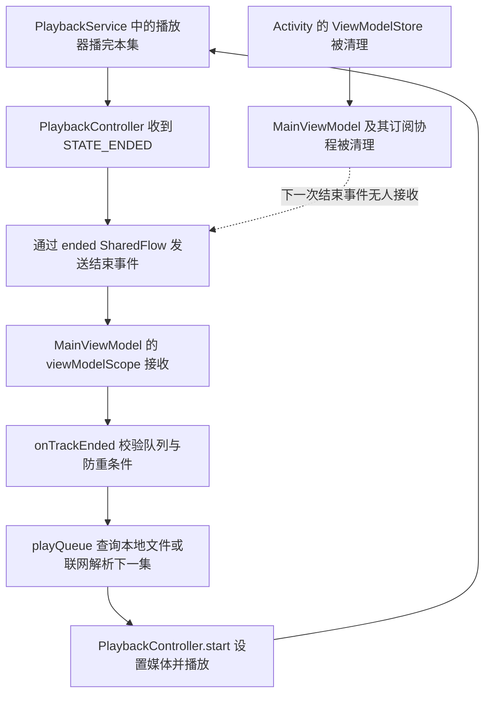

# XMPro 锁屏连续播放故障排查与修复记录

**日期：**2026-11-25（北京时间）

**作者：**long

**涉及版本：**0.1.23、0.1.24

**最终状态：**已发布 0.1.24；用户在 Redmi K80 上连续使用超过一小时，反馈播放稳定，未再出现集尾卡住。

本文按本次对话中的用户反馈、手机诊断日志、Git 提交和 GitHub Release 记录复盘。时间统一为 UTC+8；提交时间与真正的 Release 发布时间分别列出。早间日志已在当时读取和分析，当前工作区同名 `playback.log` 已被下午拉回的日志替换，本文保留早间已核对的事件与耗时摘要。

## 结论

本次遇到的“锁屏播放一集结束后不再继续”并非单一故障，而是先后确认了两个互相独立的触发点：

1. **锁屏省电期间网络/DNS 不可用。** 在线播放中的 CDN 主机名解析失败，播放器因此停止；解锁后网络恢复，播放才接续。省电豁免入口可以改善这类 Doze 限制。
2. **界面 Activity 销毁后，播放队列监听也被销毁。** 播放服务仍能继续播放当前曲目，但持有队列和自动切集监听的 `MainViewModel` 已被清理。下一集结束时没有订阅者接管事件，因而停在集尾。0.1.24 将该 ViewModel 的存活范围提升到应用进程，修复了本次最终卡集的直接原因。

用户最新验证显示 0.1.24 已连续稳定播放超过一小时。进程被 Android 完全终止后的队列恢复不属于本次修复范围，也没有由这次真机观察覆盖。

## 现场条件与最初的问题

用户描述的现场是 Redmi K80，未充电、连接 Wi‑Fi、锁屏正常在线播放。某一集能够播完，但准备切到下一集时停住；解锁并打开应用后，又开始切集播放。随后用户补充：为了取日志将手机接上电脑时，刚插线就恢复播放。

当天设备读取的型号标识为 `25060RK16C`，对应用户提供的 Redmi K80。后续读取包信息确认正式测试安装为 `teikengstudio.xmpro`、0.1.23 / versionCode 25，安装及更新时间为 12:48:43。电脑同时连接过其他手机，不能把其他设备的构建安装或运行结果算作 K80 验收。

最初不能仅凭“解锁后恢复”确定唯一根因，至少需要区分：

| 候选断点 | 应该观察到的证据 |
|---|---|
| 本集尚未真正结束，播放器在缓冲或报错 | 播放器状态、位置、缓冲位置、错误码和异常类型 |
| 播放器结束，但事件没到应用队列 | 服务的 `ended`、控制器发送记录、队列订阅数、ViewModel 接收记录 |
| 队列收到事件，但防重或定时条件阻止切集 | `queue_end_ignored` 的原因、队列索引、本集播完定时开关 |
| 已发起切集，但下一集解析没有完成 | 同一请求的解析开始、成功、失败、取消和耗时 |
| Activity 或应用进程生命周期发生变化 | ViewModel/服务的创建销毁、前后台记录、进程号 |
| Doze 或厂商后台限制影响网络 | Doze、交互状态、充电、电池豁免和网络状态随时间的变化 |

当时源码已使用 `MediaSessionService` 承载播放器，并设置 `WAKE_MODE_NETWORK`，也已有自动解析重试和播放错误恢复。因此排查重点是找到实际断点，而非继续叠加没有证据支持的重试次数。上述能力不能单凭存在就证明后台网络和队列生命周期没有问题。

## 修复前的播放链路

播放器每次只加载一个 MediaItem；在线切到下一集需要另行解析地址。实际链路如下：



`AppContainer` 与 `PlaybackController` 已经是进程范围的对象，但队列本身、自动切集订阅、片尾轮询、播放恢复和定时状态都在 `MainViewModel` 中。修复前 `ShellScreen` 使用默认 `viewModel { ... }`，因此这个 ViewModel 由 Activity 的 Store 管理。这种生命周期不一致，允许“当前音频还在播放，但负责下一集的人已退出”发生。

## 排查与修复时间线

| 北京时间 | 阶段 | 结果 |
|---|---|---|
| 09:57 | 建立诊断能力 | 为播放器服务、控制器、应用队列和地址解析增加统一日志，写入 Logcat 及应用专属文件；记录 Doze、屏幕状态、电池豁免、充电、网络状态、播放器错误和切集耗时。提交 `501c1a9`。 |
| 10:24–10:25 | 首轮诊断构建日志暴露 Doze 网络问题 | 10:24:25 当前集结束并开始解析时，设备处于 Doze、未充电且尚未豁免；首次解析约 79.5 秒后失败，网络变为 `none`。10:25:49 插线后退出 Doze、Wi‑Fi 恢复，重试约 3.44 秒成功。 |
| 10:33–10:53 | 首轮诊断构建验证省电豁免 | 10:33:18 授权生效；随后 3 次锁屏切集均一次解析成功（约 457–564 毫秒），其中两次发生在 `doze=true` 时。 |
| 11:26 / 11:32 | 提交并发布 0.1.23 | 播放设置增加用户主动开启的省电豁免入口，并加入上述诊断能力。提交 `304ca75`，Release 于 11:32 发布。 |
| 12:48–13:01 | 用户安装正式版 0.1.23 后继续测试 | 正式版有独立包名，电池豁免按应用包分别生效；新安装时日志显示正式版尚未豁免。后续日志仍捕捉到一次播放中 DNS 错误，解锁后播放器恢复。更重要的是，日志显示界面 ViewModel 在播放期间被清理，而最终集尾事件到达时没有队列订阅者。 |
| 13:20 | 修复队列监听生命周期 | 将 `MainViewModel` 放入 `XmproApp` 持有的应用级 `ViewModelStore`，使队列与自动切集订阅在 Activity 被销毁或重建后仍存在；使用 Application Context，避免长生命周期 ViewModel 保留 Activity。提交 `d5f7a62`。 |
| 13:23 / 13:27 | 提交并发布 0.1.24 | 更新版本为 `0.1.24` / versionCode `26`，创建 Release 并通过签名、版本和哈希核验。提交 `159dbf3`，Release 于 13:27 发布。 |
| 随后 | Redmi K80 真机观察 | 用户反馈已连续使用一个多小时，播放稳定，没有再出现此前集尾卡住。 |

## 日志如何定位问题

### 第一轮：省电期间网络不可用

第一份日志记录到：当前集结束时设备未充电、屏幕熄灭且处于 Doze，应用尚未获得电池优化豁免；队列确实发起了下一集地址解析，但请求期间网络从 `wifi-validated` 变成 `none`，解析失败。连接电脑后，设备变为已连接电源、退出 Doze 并恢复 Wi‑Fi，重试解析成功，播放器随后继续播放。

| 时间 | 事件及关键字段 | 判断 |
|---|---|---|
| 10:24:25.419 | 服务 `state=ended`；`doze=true`、`interactive=false`、`battery_exempt=false`、`plugged=false` | 当前集确实结束，设备处于未充电锁屏空闲状态。 |
| 10:24:25.432–10:24:25.445 | `viewmodel_ended_received` → `queue_end_accepted` → `next_url_resolve_started`，request=3 | 本轮队列收到事件并已发起下一集解析。 |
| 10:25:44.955 | `queue_request_failed`，`resolve_elapsed_ms=79510`、`network=none`、`retry=true` | 首次解析耗时 79.51 秒后失败；异常被包装成 `XmlyException`，本轮无法确认底层是否 DNS 超时。 |
| 10:25:45.963 | 同一 request=3，attempt=2，`network=none` | 现有重试逻辑已生效，没有再次推进队列跳集。 |
| 10:25:49.403 | `next_url_resolve_succeeded`，耗时 3440 毫秒；`doze=false`、`plugged=true`、`network=wifi-validated` | 连接电脑前后，系统状态与网络恢复，解析完成。 |
| 10:25:49.774 | 服务 `state=ready`、`is_playing=true` | 下一集开始播放。 |
| 10:25:53.809 | `activity_foregrounded` | 应用界面回到前台晚于播放恢复约 4 秒，打开界面不是本轮恢复的必要前提。 |

这与“插线后立刻恢复”的现场相符。**已验证的是 Doze 期间解析长时间未完成、网络状态异常，以及插线前后的恢复关联**；USB 接入同时可能改变供电、屏幕及调度状态，不能把这一观察单独视为严格的受控实验。具体 DNS 错误是在下午的另一份日志里才直接看到的。

首轮诊断构建开启省电豁免后，之后三次锁屏切集均快速成功，其中两次发生于 Doze。正式版与 Debug 版使用不同 applicationId，系统按包名保存豁免状态；安装正式版后需对正式版本身授权，Debug 版的授权不会自动迁移。

对应包名分别是 Debug 的 `teikengstudio.xmpro.debug` 与 Release 的 `teikengstudio.xmpro`。第二轮正式版日志从 `battery_exempt=false` 开始，说明前一轮诊断构建的系统授权没有自动应用到 Release 包；这解释了为何省电豁免入口看起来已经测试有效，正式包仍再次遇到一次 Doze/DNS 中断。

### 上午复测：Doze 仍开启时，切集已经成功

10:33:10 的第一次设置返回记录为 `enabled=false`；10:33:18.057 再次返回时为 `enabled=true`。随后同一轮日志中出现以下成功转场：

| 下一集解析开始时间 | Doze | 电池豁免 | 解析耗时 | 上集结束至新集开始播放 |
|---|---|---|---|---|
| 10:34:19.444 | false | true | 550 毫秒 | 919 毫秒 |
| 10:42:38.792 | true | true | 457 毫秒 | 817 毫秒 |
| 10:51:50.785 | true | true | 564 毫秒 | 913 毫秒 |

三次转场都记录为 `interactive=false`、`plugged=false`、`network=wifi-validated`，且均为第一次解析就成功。关键区别是后两次成功并不需要退出 Doze，这为省电豁免的效果提供了直接现场支持；当时仍不能据此宣布所有中断原因已经排除。

这份日志末尾还记录了三组短暂停/继续，`play_when_ready` 被改为 false 后又改为 true，`reason=1`，当时缓冲仍充足。本次核对使用的 Media3 1.4.1 常量中，1 对应 `USER_REQUEST`。这表明播放器收到了控制请求，不能凭这一字段认定一定是用户手指点击，也不应把它混同为下一集地址解析失败。

### 第二轮：队列消费者已经销毁

0.1.23 的后续日志把事件链记录得更完整：

- **12:53:09：** 当前集进入 `ended`；`viewmodel_ended_received`、`queue_end_accepted` 均出现，结束事件有 1 个订阅者，下一集解析约 253 毫秒成功，播放正常切换。
- **12:58:35：** 播放中的音频发生 `ERROR_CODE_IO_NETWORK_CONNECTION_FAILED`，异常链包含 `UnknownHostException` 和 `GaiException`；当时日志显示 `doze=true`、`network=none`、`battery_exempt=false`。
- **12:58:50–12:58:58：** 解锁后 Doze 退出、Wi‑Fi 恢复；原曲恢复播放，正在进行的地址解析最终成功。
- **12:59:09–12:59:11：** 实时诊断先在 12:59:09.170 读到 `battery_exempt=true`，设置返回回调在 12:59:11.155 确认 `enabled=true`；中断发生在授权之前。
- **13:00:20：** 出现 `viewmodel_cleared`，但记录的 `is_playing=true`，队列仍在内存状态中（索引 33，共 2670 集）。这证明 ViewModel 在播放器仍运行时结束了生命周期。
- **13:01:51：** 播放服务报告当前这一集结束；控制器记录 `controller_ended_emit`，但 `subscriber_count=0`。没有 `viewmodel_ended_received`，队列无人推进，因此停在集尾。

这条证据将本次卡集的直接断点定位在**播放器服务发出集尾事件之后、应用队列接收之前**，而不是上一集没有播完或队列主动跳过。

以下为下午日志中提取的关键字段。为便于阅读，时间已转为北京时间，未列出的字段是省略而不是缺失：

```text
12:58:35.775 event=service_player_error doze=true battery_exempt=false network=none
             error_code=2001 error_name=ERROR_CODE_IO_NETWORK_CONNECTION_FAILED
             cause_types=m>y>UnknownHostException>GaiException

13:00:20.340 event=viewmodel_cleared pid=12654 is_playing=true
             queue_index=33 queue_size=2670 battery_exempt=true

13:01:51.348 event=service_player_state pid=12654 state=ended
             doze=false interactive=false battery_exempt=true network=wifi-validated
13:01:51.364 event=controller_ended_emit pid=12654
             emit_accepted=true subscriber_count=0
```

这里有三个决定性细节：

1. 从应用启动、ViewModel 清理到最后集尾，进程号均为 12654，服务继续给出状态；最终卡住不能解释为整个进程已被杀掉。
2. 最后集尾时已经豁免、网络为 `wifi-validated`，也没有开启“本集播完停止”的记录；此时首要问题是队列消费者不存在。
3. `emit_accepted=true` 只说明 `tryEmit()` 接受了发送。该 SharedFlow 没有配置 replay；当订阅数为 0 时，该结果并不代表事件被处理，`extraBufferCapacity` 也不能代替一个活着的消费者。

日志没有记录 Activity 是因返回退出、任务移除还是其他生命周期行为结束，不能推断具体用户动作。但对本次修复而言，正常退出或系统清理界面都不应让仍在播放的服务失去下一集队列。

另外，下午第一次网络中断发生在该集约 **5 分 25 秒**（`position_ms=325475`），全长约 **8 分 18 秒**。因此它是播放中的网络错误，不是所有“停住”都发生在集尾。日志中的恢复请求 `automatic=false` 表示它不是“自动推进下一集”请求；同集错误恢复也使用这个值，不能据此认定没有自动恢复。

## 代码修复

### 0.1.23：诊断日志与省电豁免入口

- 新增 `PlaybackDiagnostics`，统一输出墙钟和单调时钟、进程号、Doze/交互状态、省电模式、电池豁免、是否充电、网络传输类型和播放器/队列事件。
- 记录自动切集的开始、结束、拒绝、重试、取消、异常类型链、HTTP 状态和耗时，以区分事件未送达、队列拒绝、网络解析失败与播放器启动失败。
- 同时写 Logcat（tag `XMProPlayback`）和应用专属诊断文件，单文件上限约 512 KiB，保留上一份轮转文件。
- 日志不记录曲名、媒体 ID、播放 URL、Cookie 或账号凭据。
- 播放设置增加“锁屏连续播放”入口。用户点选后才进入 Android 电池优化授权流程；页面显示当前豁免状态并提示可能增加待机耗电。它不能替代某些厂商系统单独的后台运行设置。

### 0.1.24：队列和切集监听随应用进程存活

- `XmproApp` 实现 `ViewModelStoreOwner` 并持有进程级 `ViewModelStore`。
- `ShellScreen` 从该 Store 获取 `MainViewModel`，Activity 重建或销毁不会清掉队列、自动切集 collector 和相关协程。
- 创建该 ViewModel 时只传 `Application` Context，避免应用级对象持有已销毁的 Activity。
- 播放服务仍负责音频和 MediaSession；本次没有把解析/账号逻辑搬进服务。队列协调仍在应用进程中，但其生命周期不再与界面 Activity 绑定。

修复前后对象的归属如下：

| 对象/工作 | 修复前 | 0.1.24 |
|---|---|---|
| ExoPlayer 与 MediaSession | `PlaybackService` | `PlaybackService` |
| AppContainer 与 PlaybackController | Application 持有 | Application 持有 |
| MainViewModel 及播放队列 | Activity 的 ViewModelStore 持有 | `XmproApp.viewModelStore` 持有 |
| 自动切集与通知上一集/下一集的订阅 | 随 Activity 的 VM 一起结束 | 同一进程内跨 Activity 存活 |
| 传入 MainViewModel 的 Context | Compose 的 LocalContext，当前为 Activity Context | `XmproApp`，即 Application Context |
| UI 对播放状态的收集 | 随界面生命周期收集 | 仍随界面生命周期收集 |

实现时曾比较过将队列单独抽成播放协调器、让服务直接管理完整队列，以及延长现有 ViewModel 生命周期三种方案。最终采用最后一种：保留已有队列筛选、在线解析、播放恢复、定时和账户逻辑，只改变对象所有权。发布的补丁只改了 `XmproApp.kt` 和 `ShellScreen.kt`，没有引入独立的播放协调器。

这意味着**整个 MainViewModel**，包括它持有的主页、账号等 UI 数据，也会随应用进程存活，不能把最终实现描述为“只提升了播放队列的生命周期”。这是本次小范围修复的取舍。原有 `Updater.open()` 与 `Updater.install()` 已为外部 Activity Intent 设置 `FLAG_ACTIVITY_NEW_TASK`，核对后可继续使用 Application Context；其他存储、日志和 ContentResolver 调用也不依赖具体 Activity。

仅增大 SharedFlow 缓冲不能解决该问题：缓冲不会让已被清理的 ViewModel 恢复，也不能重建它丢失的完整队列。仅延长播放器 WakeLock 同样不会创建结束事件的消费者。最终补丁针对的是日志证明存在的生命周期断点。

### 按文件列出的改动

以下链接指向仓库源码；复盘中的具体版本以随后列出的提交和 tag 为准。

| 文件 | 本次改动及目的 |
|---|---|
| [AndroidManifest.xml](../android/app/src/main/AndroidManifest.xml) | 新增普通权限 `ACCESS_NETWORK_STATE`，使日志能读取网络概况。`REQUEST_IGNORE_BATTERY_OPTIMIZATIONS` 原本就已声明，本次补的是实际设置入口。 |
| [PlaybackDiagnostics.kt](../android/app/src/main/kotlin/teikengstudio/xmpro/player/PlaybackDiagnostics.kt) | 新增状态日志、时间戳、进程号、安全异常类型链及文件轮转，支持脱离电脑后的故障取证。 |
| [PlaybackService.kt](../android/app/src/main/kotlin/teikengstudio/xmpro/player/PlaybackService.kt) | 记录服务创建/销毁、任务移除、播放器状态、播放意图改变和播放异常，证明服务在故障时是否仍运行。 |
| [PlaybackController.kt](../android/app/src/main/kotlin/teikengstudio/xmpro/player/PlaybackController.kt) | 记录连接、播放命令、集尾发送是否被接受及订阅者数量；后者直接揭示了最终卡集原因。 |
| [MainViewModel.kt](../android/app/src/main/kotlin/teikengstudio/xmpro/ui/MainViewModel.kt) | 记录队列接收、请求、解析耗时、拒绝原因、重试、取消、前后台和清理事件。现有重试与防重策略得到诊断覆盖。 |
| [SettingsScreen.kt](../android/app/src/main/kotlin/teikengstudio/xmpro/ui/SettingsScreen.kt) | 增加锁屏连续播放省电豁免入口、授权状态和耗电说明，并在设置返回时刷新状态。 |
| [XmproApp.kt](../android/app/src/main/kotlin/teikengstudio/xmpro/XmproApp.kt) | 先增加进程启动日志；0.1.24 再实现 `ViewModelStoreOwner`，持有应用级 ViewModelStore。 |
| [ShellScreen.kt](../android/app/src/main/kotlin/teikengstudio/xmpro/ui/ShellScreen.kt) | 从 Application 的 Store 获取唯一 MainViewModel，并传入 Application Context，避免 Activity 退出时自动切集退订。 |
| [app/build.gradle.kts](../android/app/build.gradle.kts) | 0.1.23 的 versionCode 为 25；0.1.24 升为 26，正式包名和原有签名配置保持一致。 |
| [CHANGELOG.md](../CHANGELOG.md) | 分别记录省电豁免/日志能力以及界面退出后的自动切集修复。 |

上午还有一项“我的”页面统计内容垂直居中的提交 `9d4b8fa`，随 0.1.23 一同发布。它属于界面调整，不是锁屏播放修复。本次复盘也不把更早版本已有的音频焦点、网络 WakeMode、解析重试和播放器错误恢复重复算作今天新增功能。

### 提交定位

| 提交 | 北京时间 | 内容 |
|---|---|---|
| [501c1a9](https://github.com/lonnnnnng/XMPro/commit/501c1a9556b96cd45671d03334e6595d647281a7) | 09:57:26 | 增加锁屏切集诊断日志及省电豁免入口。 |
| [304ca75](https://github.com/lonnnnnng/XMPro/commit/304ca7540569a0f8f9b602f41b26b51e749b61aa) | 11:26:23 | 发布 0.1.23 的版本与更新说明。 |
| [d5f7a62](https://github.com/lonnnnnng/XMPro/commit/d5f7a62f2ba4326ffa2a4d57766ea509797d3ed8) | 13:20:22 | 修复锁屏自动切集监听随界面销毁。 |
| [159dbf3](https://github.com/lonnnnnng/XMPro/commit/159dbf38846313f67ef7f1972bbc9f0d2cc828b1) | 13:23:54 | 发布 0.1.24 的版本与更新说明。 |

## 构建与发布核验

- 0.1.23 与 0.1.24 的 Debug 构建均成功；0.1.24 本地 118 项单元测试通过。
- 0.1.24 的 GitHub tag 发布和 `main` 分支校验流水线均成功。
- 远端 Release APK 核验结果：包名 `teikengstudio.xmpro`、versionName `0.1.24`、versionCode `26`；`SHA256SUMS` 与 APK 文件摘要一致；签名证书与 0.1.23 相同，可直接升级。
- Release APK 大小 2,767,704 字节；SHA-256：`ac49dde2edabb5af6e9259b8c9b1489a1ab906e641465aebce01b5af0c2675d4`。
- Release 于 13:27（北京时间）发布；tag 发布流水线与 main 校验流水线均成功：<https://github.com/lonnnnnng/XMPro/actions/runs/45553360592>、<https://github.com/lonnnnnng/XMPro/actions/runs/45553360878>。
- 0.1.24 Release：<https://github.com/lonnnnnng/XMPro/releases/tag/v0.1.24>

0.1.23 于 11:32:22 发布，0.1.24 于 13:27:42 发布。两个版本均为正式 Release。0.1.23 的 APK SHA-256 为 `a17c6a9eb87471e1b0c3b365216b967c1d45035e1a1bf36e07706a5509e0eaa8`；两版证书 SHA-256 均为 `74696b2560cef4bdcbfebb21dba970d1c0bc70a83c34f60bf997afe49320e2cb`。发布期间沿用了已有仓库签名 secrets，没有更换 XMPro 的发布证书。

各项验证的含义如下，避免将构建成功等同于真机连续播放成功：

| 验证项 | 结果与证明范围 |
|---|---|
| 本地 `:app:testDebugUnitTest :app:assembleDebug` | 生命周期补丁完成后，现有 118 项单元测试通过，失败/错误/跳过均为 0，Debug APK 构建成功。升版本号后的检查复用已通过的测试结果，Gradle 显示 `UP-TO-DATE`。 |
| GitHub main 校验 | run `45553360878` 成功，构建并运行仓库现有单测。 |
| GitHub v0.1.24 发布 | run `45553360592` 成功，完成签名、APK 验证和 Release 上传。 |
| 远端资产回验 | 重新下载 APK 与 SHA256SUMS，核实版本、包名、文件摘要和签名证书；远端 main 与 tag 均指向 `159dbf3`。 |
| 上午诊断构建真机日志 | 证明豁免开启后 3 次锁屏自动切集成功，其中 2 次仍处于 Doze。 |
| 0.1.24 用户真机验收 | 用户反馈连续使用一个多小时，稳定且未再出现原来的卡住；本轮没有另外拉取这一个多小时的完整新日志，所以不虚构切集次数或逐秒稳定性统计。 |

本次没有新增专门模拟 Activity 销毁的自动化回归测试。现有单测提供代码层回归检查，用户安装正式包后的连续使用提供实际效果反馈，二者共同构成本次验收证据。

## 诊断日志读取

Release 版应用专属文件目录：

```text
/sdcard/Android/data/teikengstudio.xmpro/files/xmpro/diagnostics/
```

在 macOS 终端先查看连接的设备，将下面的序列号替换为目标手机。用独立时间戳目录保存每一轮日志，避免像这次一样被后一次同名文件覆盖。若还未发生轮转，上一份文件不存在是正常现象。

```sh
adb devices -l
XM_DEVICE_SERIAL='替换为目标手机序列号'
XM_LOG_DIR="Temp/xmpro-playback-$(date +%Y%m%d-%H%M%S)"
mkdir -p "$XM_LOG_DIR"
adb -s "$XM_DEVICE_SERIAL" pull /sdcard/Android/data/teikengstudio.xmpro/files/xmpro/diagnostics/playback.log "$XM_LOG_DIR/playback.log"
adb -s "$XM_DEVICE_SERIAL" pull /sdcard/Android/data/teikengstudio.xmpro/files/xmpro/diagnostics/playback.previous.log "$XM_LOG_DIR/playback.previous.log"
```

也可在 Logcat 环形缓冲尚未覆盖时读取最近事件：

```sh
adb -s "$XM_DEVICE_SERIAL" logcat -d -v threadtime -s XMProPlayback:I '*:S' > "$XM_LOG_DIR/logcat.txt"
```

诊断文件会随卸载或清除应用数据而删除。日志反映事件发生时的系统状态；网络 `none` 和异常类型可以确认故障类别，但不能单独证明限制来自 Android Doze 还是设备厂商策略。

以上命令针对 Release 包；诊断 Debug 包应改用 `teikengstudio.xmpro.debug` 目录。日志默认写外部应用专属目录，外部目录不可用时会回退内部 `filesDir`；该回退文件不保证能直接用普通 ADB pull 读取。本次已成功拉回的是外部目录日志。

USB 插线本身会改变供电或空闲状态，可能像本次一样让故障立即恢复。遇到这种情况不必为了“保持卡住”反复重现，已经落盘的插线前后日志仍可用于对齐事件。尽量先不要清数据、卸载、重启应用或手动反复跳集，并记录观察到停止的大致时间。完成诊断后再整理和清理临时副本。

快速判别时，可按下表逐级定位：

| 事件组合 | 优先调查方向 |
|---|---|
| `service_player_error` + `UnknownHostException` + Doze/网络异常 | 当前流的网络或 DNS 失败，以及对应包的豁免状态。 |
| `service_player_state state=ended` + `subscriber_count=0` | 播放队列的生命周期和事件订阅。 |
| 收到结束事件但出现 `queue_end_ignored` | 媒体项是否过期、防重时间窗、空队列等具体拒绝原因。 |
| `next_url_resolve_started` 长时间无结果 | 解析任务进度、网络、线程调度、取消或进程生命周期；没有结果本身不能证明一定是网络。 |
| 解析成功但服务未进入 `ready/is_playing=true` | 媒体加载、播放命令、音频焦点和播放器异常。 |

当前日志有一个读法细节：通用 `elapsed_ms` 是单调时钟，有的解析成功事件又用同名 `elapsed_ms` 表示请求耗时；使用简单键值字典时后者会覆盖前者。复盘的跨事件时间线使用 `wall_ms` 转换值，单次解析耗时采用该事件的请求耗时字段，不能混算。

## 当前结论与后续观察

当前已由日志确认并修复的卡集直接原因是：**Activity 级 ViewModel 在播放器仍运行时被清理，导致集尾时队列订阅数为 0。** 电池优化豁免解决的是另一项真实出现过的 Doze/DNS 网络触发因素。两项修复共同覆盖了“播放中断后恢复”和“集尾自动切下一集”这两条路径。

用户的最终反馈是：

> 这下好像可以了，已经使用了一个多小时了。很稳定。没再出现前面那种卡住的情况。

据此，本次“锁屏卡住、解锁或插线后恢复，以及界面退出后集尾停住”的问题已完成从现场反馈、落盘取证、分层定位、代码修复、正式发版到用户验收的闭环。后续继续按日常使用观察即可，当前没有证据支持再叠加保活或重试改动。

本次解决范围及实现取舍仍需保留：

- 电池优化豁免按应用包生效，正式版需确认自己的授权；它不会代替厂商的全部后台策略，也不能修复真实断网。
- 应用级 ViewModel 仍依赖当前进程存活；完整队列尚未持久化，进程被彻底终止后的自动恢复没有实现。
- 整份 MainViewModel 会驻留到进程结束；未来若拆分播放协调模块，应在保留后台单一队列所有者的前提下进行。
- 一小时以上无复发是当前用户真机验收结果，不等于所有机型、系统版本和长时异常场景的穷尽测试。

## 同日相关项目的处理

用户同日还要求修复音流项目的类似现象。音流已有切歌 CPU/Wi‑Fi 锁、前台服务转场保护和自动重试，本次在播放设置补了“锁屏后台联网”的电池优化豁免入口及 Manifest 声明，并发布 [音流 1.0.29](https://github.com/lonnnnnng/yinliu/releases/tag/v1.0.29)。其 206 项单元测试、Android 测试 Kotlin 编译和本地 Debug/Release 构建通过。

该项修改属于第一类省电联网问题的处理；XMPro 后续在 0.1.24 实施的应用级 ViewModel 修复没有同步到音流。音流未在本次会话中提供相同的 `subscriber_count=0` 现场证据，也未得到相同的一小时真机验收反馈，不能把 XMPro 的最终验证结论直接套用到音流。
